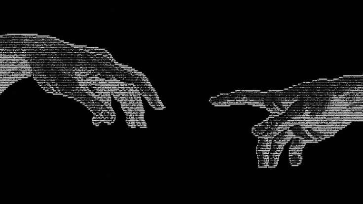

# Teisha

──────୨ৎ────────୨ৎ────────୨ৎ────────୨ৎ────────୨ৎ──────

I'm learning to build games, with a long-term goal of specialising in AI. I also make Notion templates.

## Stack

## Tools

──────୨ৎ────────୨ৎ────────୨ৎ────────୨ৎ────────୨ৎ──────

## My First Game

**YOUR GAME NAME HERE**

This was the first coding project I ever built, made in semester 1 with JavaScript and p5.js. I loved every minute of it. Watching something I wrote turn into a game I could actually play is the moment I knew I wanted to go into game development.

It's what started everything for me, and it's the reason I'm now learning more every day, with AI for games as my next goal.

──────୨ৎ────────୨ৎ────────୨ৎ────────୨ৎ────────୨ৎ──────

## Notion Templates

I design Notion templates for just about everything.

──────୨ৎ────────୨ৎ────────୨ৎ────────୨ৎ────────୨ৎ──────

